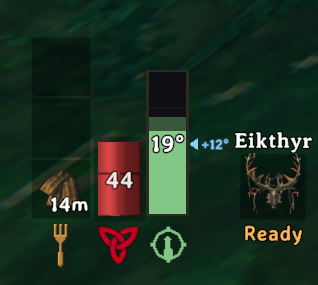
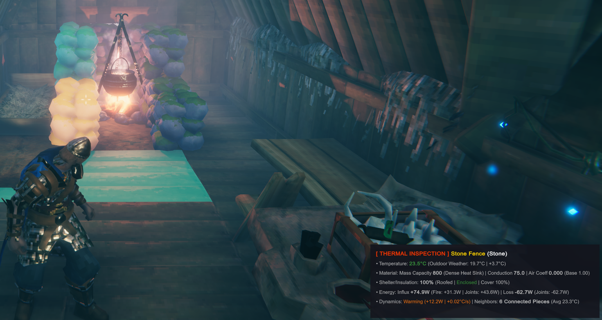

# VikingClimate

**By DigitalVikings**

VikingClimate replaces Valheim's binary Cold and Freezing checks with a physically grounded thermodynamic climate and building-insulation simulation. Internal body warmth, 17-point microclimatic biome blending, structural thermal mass, convective hearth heating, gear insulation, and progressive hypothermia/hyperthermia turn shelter design and expedition prep into meaningful survival craft.

> ⚡ **Powered by VikingLib**: Requires [DigitalVikings-VikingLib](https://valheim.thunderstore.io/package/DigitalVikings/VikingLib/) (`0.4.0+`), Jötunn, and BepInExPack Valheim. All balance settings synchronize automatically from server to clients.

---

## Core Features (v0.4.0)

### Environmental Microclimates & Body Warmth
- **17-Point Spatial Microclimates**: Outdoor "feels-like" temperature blends smoothly across biome borders and accounts for elevation lapse (-1°C per 35m above sea level), diurnal day/night cycles, precipitation/blizzards, subterranean ground insulation, and optional third-party Season mods.
- **Continuous Thermal Conduction**: Your character maintains an internal body warmth (comfort equilibrium `18°C`–`26°C`, centered at `22°C`) that warms or cools dynamically based on wetness, swimming, wind exposure, gear cold insulation, and resting recovery.
- **Sensory Immersion & Thermometer HUD**: Cold breath vapor scales with freezing air and exertion, subtle screen-edge frost and heat mirage vignettes signal extreme exposure, and an auto-anchored thermometer HUD tracks live body warmth, trend arrows, and ambient target (compatible with both vanilla UI and Project Auga).

### Structural Thermal Graph & Dwelling Architecture
- **Connected Building Thermal Mass**: Snapped structural pieces (Stone, Core Wood, Wood, Metal, and Crystal) form a live thermal network that absorbs fire heat, conducts across joints, radiates warmth into rooms, and persists piece temperatures across sessions.
- **Dissimilar Material Joint Insulation**: A configurable thermal barrier (default **95% reduction**) applies across joints between different material classes—so lining the inside of a stone keep with wooden paneling insulates your interior against exterior stone heat loss.
- **Convective & Radiant Heating**: Campfires, hearths, standing/hanging braziers, bonfires, torches, kilns, smelters, and blast furnaces warm nearby structures via proximity convection (and optional legacy raycasting) with per-piece absorption caps. Furniture, workstations, and decorations do not block indoor convective heat.
- **Crystal Windows & Envelopes**: Crystal walls and glass panes actively conduct heat, absorb radiant fire warmth, and seal indoor climate envelopes without creating freezing dead zones.
- **Dwelling-Wide Comfort & Thermal Resting**: Comfort pieces (beds, chairs, rugs, banners, hearths) propagate across the entire connected enclosed dwelling rather than a rigid 10m sphere. Entering and maintaining the **Resting** state responds to comfortable indoor temperature (`18°C`–`28°C` by default) instead of hugging a campfire.

### Inspection Tools & Hugin's Compendium
- **Hugin's Compendium Thermal Breakdown**: Open Hugin's Compendium (`Character Stats` — or the Project Auga Player Stats sheet) for a live **Thermal & Climate** breakdown showing body warmth, active thermal tier, heat transfer rate, gear insulation & Frost Mead resistance, structural shelter enclosure & hearth warmth, environmental deltas, dwelling comfort breakdown, and active divine ward protection.
- **Piece Insulation Visualizer**: Toggle real-time color-coded world shading (Green = fully insulated, Yellow = partial shelter, Red = exposed heat leak) to spot drafts and uninsulated walls while building.
- **Crosshair Thermal Inspector**: Inspect individual pieces or entire connected dwellings with a high-contrast dark backdrop HUD (`F7` toggle inspector, `F8` switch single-piece vs. whole-dwelling graph view, `L` lock active heat source highlights).

### Ecosystem Interoperability
- **VikingWards (Thor Tier 3 — Stormcaller's Aegis)**: When `VikingWards` is installed, standing inside an active Tier 3 Thor ward automatically shields you from storm temperature drops, wind chill, rain wetness accumulation, and sub-zero freezing tiers—displayed live in Hugin's Compendium.
- **Project Auga & Season Mods**: Auto-anchors the thermometer clear of Auga layouts, feeds live thermal stats into Auga's Player sheet, and offers opt-in integration with Seasonality / Seasons mods.

---

## Thermal Mechanics Reference

<b>Thermal Conduction Modifiers (Default Values)</b>

| Condition | Rate Effect | Mechanical Behavior |
| :--- | :--- | :--- |
| **Base Conduction Rate** | `0.005 /s` | Baseline conduction speed toward ambient feels-like temperature. |
| **Wet (`Wet`)** | `2.0x` | Doubles conductive cooling and applies -5% movement speed from waterlogged gear. |
| **Swimming** | `3.0x` | Submersion in water triples conductive heat loss. |
| **Wind Exposure** | Up to `2.2x` | Open wind accelerates convective cooling (fully blocked by shelter, dungeons, or Stormcaller's Aegis). |
| **Gear Cold Insulation** | Up to `90%` (`95%` w/ Mead) | Fur, quilted linen, and alpine armor mitigate cold heat loss (inactive when warming up). |
| **Resting / Sleeping** | `25.0x` | Resting in a warm dwelling rapidly restores body warmth toward comfort equilibrium (`22°C`). |

<b>8-Tier Progressive Hypothermia & Hyperthermia System</b>

Native binary Cold and Freezing effects are replaced with 8 configurable stages applied through VikingLib:

### Cold Progression (Hypothermia)
| Stage | Body Warmth | Default Penalties |
| :--- | :--- | :--- |
| **Comfort** | `18°C` to `26°C` | Physiological equilibrium. No penalties. |
| **Chilly** | `8°C` to `18°C` | Stamina Regen `-10%`, All Damage `× 0.90`. |
| **Bitter Cold** | `0°C` to `8°C` | Stamina Regen `-30%`, All Damage `× 0.80`. |
| **Numbing Frost** | `-12°C` to `0°C` | Stamina Regen `-45%`, All Damage `× 0.65`, Attack Speed `× 0.85`. |
| **Hypothermia** | `< -12°C` | Stamina Regen `-70%`, All Damage `× 0.40`, Attack Speed `× 0.70`, Frost Damage `1.5 HP/s`. |

### Heat Progression (Hyperthermia)
| Stage | Body Warmth | Default Penalties |
| :--- | :--- | :--- |
| **Warm** | `26°C` to `35°C` | Movement Speed `× 0.95`, Attack Speed `× 0.95`. |
| **Heat Exhaustion** | `35°C` to `45°C` | Movement Speed `× 0.80`, Attack Speed `× 0.80`. |
| **Severe Hyperthermia** | `45°C` to `55°C` | Movement Speed `× 0.65`, Attack Speed `× 0.65`. |
| **Catastrophic Scorching** | `> 55°C` | Movement Speed `× 0.50`, Attack Speed `× 0.50`, Fire Damage `2.0 HP/s`. |

---

## Configuration

Settings are organized into 14 numbered sections inside `BepInEx/config/com.digitalvikings.vikingclimate.cfg` (editable in-game with Configuration Manager, with automatic legacy migration and server-authoritative sync on gameplay values):

- **01 - General**: Master enable toggle and diagnostic logging.
- **02 - Comfort & Resting**: Comfort temperature bounds, dwelling-wide comfort toggle, thermal resting window & delays, and optional warmth-to-sleep requirement.
- **03 - Body Thermodynamics**: Base conduction rate, gradient elasticity, resting reversion speed, wetness, and swimming multipliers.
- **04 - Cold Stages & Debuffs** / **05 - Heat Stages & Debuffs** / **06 - Consequences & Damage**: Live-reloading stat penalties and periodic frost/fire damage rates for all 8 thermal stages.
- **07 - Environmental & Shelter** / **08 - Structural Thermal Graph**: Scan intervals, enclosure threshold, dissimilar material joint resistance, relaxation rate, and offline building heat behavior (`Freeze`, `DecayWhenUnlit`, `AlwaysDecay`).
- **09 - Heat Raycasting** / **10 - Heat Convection**: Independent toggles, radii, per-source wattage budgets, and per-piece absorption limits for every fire and industrial furnace type.
- **11 - Material Physical Properties**: Heat capacity, air loss, conductivity, and radiant absorption for Stone, Wood, Core Wood, Metal, and Crystal.
- **12 - UI & Thermometer HUD**: Thermometer visibility, auto vs. custom coordinates, scale, and frost/heat vignette thresholds and opacity.
- **13 - Compatibility**: Opt-in seasonal temperature integration for Seasonality / Seasons mods.
- **14 - Inspection & Debugging**: Piece insulation visualizer toggle, instant graph equilibrium solver, inspection hotkeys (`F7`, `F8`, `L`), and calibration overrides.

---

## Installation & Requirements

1. Install **BepInExPack Valheim** (`5.4.2202+`).
2. Install **Jötunn** (`2.20.1+`).
3. Install **DigitalVikings-VikingLib** (`0.4.0+`).
4. Install **DigitalVikings-VikingClimate** via Gale / r2modman or extract into `BepInEx/plugins/`.
